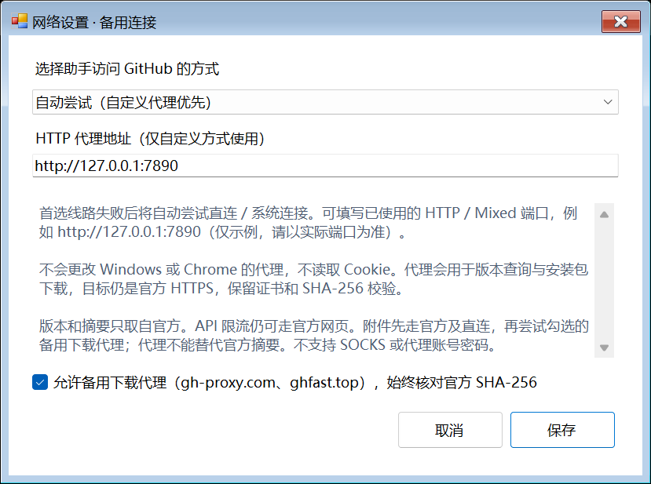

# 网络连接与自动备用方案（v1.7.0）

## 直接完成更新：一条失败，继续下一条

无需在每次错误后手动改代理。版本检查和附件下载有各自的备用流程。

### 版本和官方摘要

1. 首选连接的官方 GitHub API。
2. API 不可用或正在限流时，转到官方 Releases 网页，读取最新稳定标签和对应附件 SHA-256。
3. 当前连接无法访问时，自动尝试直连；首选直连或自定义代理时，也保留系统连接作为备用。

API 的恢复时间仅限制 API 请求；不会把等待状态套到网页和附件下载。不会通过不停轮换 API 出口来重复请求同一个受限接口。

### 下载和安装

1. 官方下载地址，使用首选连接。
2. 官方下载地址，改用直连 / 系统备用连接。
3. `gh-proxy.com` 下载代理。
4. `ghfast.top` 下载代理。

第三方代理也会尝试首选 / 直连连接。每次失败会显示当前线路并继续下一条；每条连接有超时，整体下载最多 10 分钟，期间可取消。

代理只传输安装包：**版本和 SHA-256 始终取自官方 API / 官方网页**。代理文件必须匹配该官方摘要，随后还要检查包结构、产品名、版本与架构，再执行原有备份与原子替换。

错误文件和未完成的下载在重试前删除，下一线路从零下载，不拼接不同来源内容。全部方案失败才会结束并保留现有程序。

## 网络设置

网络设置的连接方式是“优先使用”，不再是唯一可用线路：

- **自动尝试（系统代理优先）**：默认方案，失败后尝试直连。
- **自动尝试（直连优先）**：直接连接官方服务，失败后尝试系统连接。
- **自动尝试（自定义代理优先）**：填写你实际使用的 HTTP / Mixed 端口，失败后还会尝试直连和系统连接。`http://127.0.0.1:7890` 只是示例，不会擅自填写或启动代理。

可以取消勾选“允许备用下载代理”，只使用官方地址和本地连接方式。设置保存在助手旁 `update-helper-data/network.json`；不修改 Windows 或 Chrome 代理，不读取 Cookie、Token、配置或数据库内容。

自动直连可能使用不同于首选代理的网络出口。此行为只作用于本工具访问公开更新文件。自定义代理暂不支持 SOCKS 或账号密码。

## 反向代理/API 代理的取舍

公共 API 反代不是当前安装的信任来源：若同一第三方同时提供哈希和安装包，哈希一致也不能独立确认官方来源。

本版采用官方 API + 官方网页两套元数据路径，并用公开下载代理作为文件传输备用。代理接口可变化；不自动接受未列出的代理域名，也不把未知跳转跟随到任意站点。要增加新服务，应更新域名允许范围及相应测试。

参考项目/服务说明（2026-10-26 检查）：
- https://github.com/hunshcn/gh-proxy
- https://gh-proxy.com/
- https://ghfast.top/

公共服务可能暂时失效或限速，程序将如实记录失败并继续其他方案。2026-10-26 实测三个下载路径都能取得相同官方便携包，见 [真实验收记录](multi-route-verification.md)。

## 错误信息和浏览器入口

配额耗尽、频率限制、普通 403、网关返回非 JSON、401、407、404、5xx、DNS 与证书错误分别提示。HTTPS 证书验证不会关闭。

“浏览器打开官方发布页”作为最后的手动入口，使用系统默认浏览器；Chrome 是默认浏览器时会用 Chrome。主更新流程会先自动尝试可用路径，不以打开浏览器替代更新。
